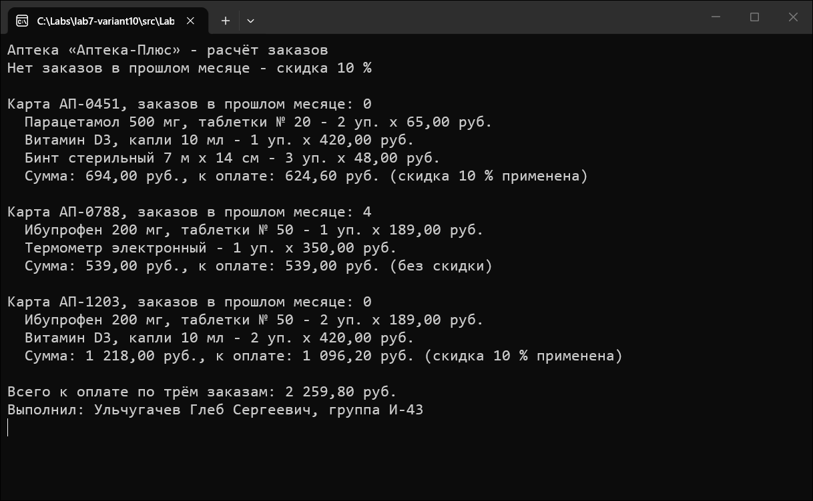
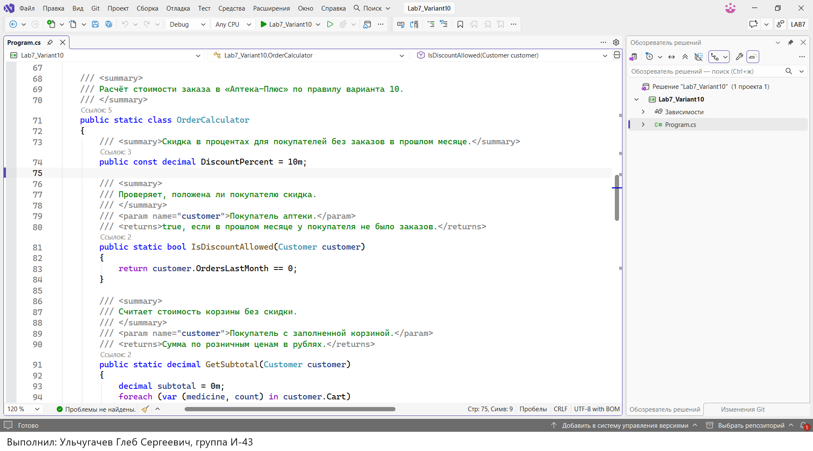
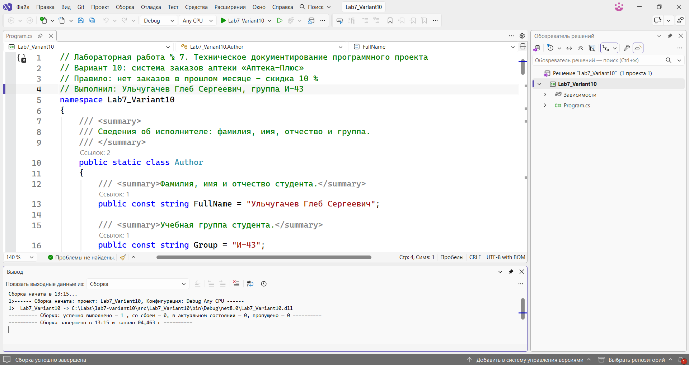
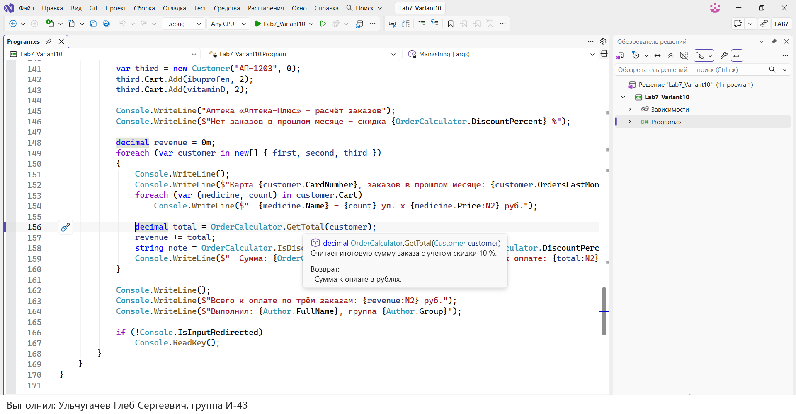

# Система заказов компании «Аптека-Плюс»

**Автор:** Ульчугачев Глеб Сергеевич, группа И-43

**Репозиторий:** https://github.com/Wraithbrusleeve/lab7-variant10

Лабораторная работа № 7 «Техническое документирование программного проекта», вариант 10.

## Что делает программа

- хранит ассортимент аптеки: название препарата, форму выпуска и цену за упаковку;
- собирает корзины покупателей по номеру дисконтной карты;
- проверяет, были ли у покупателя заказы в прошлом месяце;
- если заказов не было, даёт скидку 10 % на весь заказ;
- выводит сумму каждого заказа без скидки и к оплате, общий итог и сведения об авторе.

## Как запустить

1. Открыть файл `src/Lab7_Variant10.sln` в Visual Studio 2022 версии 17.8 или новее, подойдёт и Visual Studio 2026. Нужен .NET 8 SDK, он ставится вместе со средой при выборе рабочей нагрузки «Разработка классических приложений .NET».
2. Нажать F5 или кнопку «Пуск».
3. Посмотреть результат в окне консоли и нажать любую клавишу для выхода.

Без Visual Studio программу можно запустить командой `dotnet run --project src/Lab7_Variant10` из корня проекта.

## Структура проекта

| Файл или папка | Назначение |
|---|---|
| `src/Lab7_Variant10.sln` | решение Visual Studio |
| `src/Lab7_Variant10/Program.cs` | исходный код с XML-комментариями |
| `docs/` | скриншоты для этого файла |
| `README.md` | описание проекта |

Классы программы: `Author` (фамилия и группа), `Medicine` (препарат), `Customer` (покупатель и корзина), `OrderCalculator` (расчёт скидки и суммы), `Program` (точка входа).

## Скриншоты

### Скриншот 1: Результат работы программы

### Скриншот 2: XML-комментарии в коде

### Скриншот 3: Среда разработки

### Скриншот 4: Подсказка IntelliSense из XML-комментария

